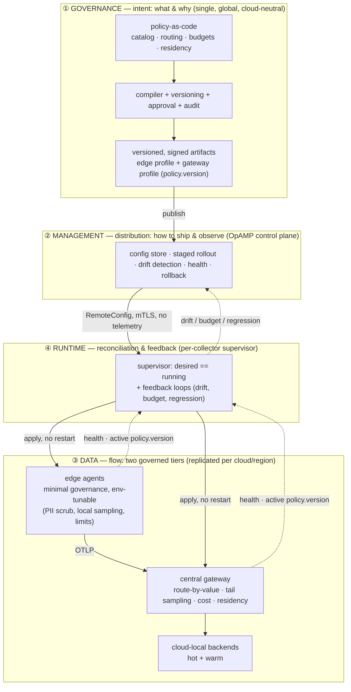

# A four-plane governance model for OpenTelemetry Collector fleets

*Part 1 of 3 — the model. Part 2 is the [otel-gateway case study](./otel-gateway-multicloud-case-study.en.md); Part 3 is the [OpAMP management plane](./opamp-management-plane.en.md) in depth. Reference implementation: [otel-gateway](https://github.com/).*
*🌐 [Versão em português](./governance-model-collector-fleets.pt-BR.md)*

## TL;DR

- Configuring **one** OpenTelemetry Collector is solved. Governing a **fleet** of
  them — across clouds, teams, and compliance boundaries — is not, and there is
  **no canonical model** for it: vendors and glossaries each define "control
  plane" / "management plane" / "telemetry plane" differently.
- This article proposes a concrete model: **four planes** with distinct
  responsibilities, distinct failure modes, and — the part most write-ups skip —
  **explicit interfaces (contracts) between them**.
  - **Governance plane** — *intent: what & why.* Policy-as-code, versioning,
    approval, audit. Single, global, cloud-neutral.
  - **Management plane** — *distribution: how to ship & observe.* An OpAMP-based
    control plane: inventory, config push, staged rollout, drift detection,
    central rollback.
  - **Data plane** — *flow: what goes where.* The collectors. **Two governed
    tiers**, not one smart gateway: a minimal, environment-tunable governance
    layer at the edge, and the authoritative pipeline at a central gateway.
  - **Runtime plane** — *reconciliation & feedback.* A per-collector supervisor
    that makes *desired* state (from Management) equal *running* state (in Data),
    plus the closed feedback loops.
- Two design principles make the model more than a diagram: **distributed
  governance** (load is shared across tiers; the central gateway is not a SPOF)
  and **central guardrails + local tuning** (the edge may only tune parameters
  *within* centrally-declared bounds).
- In **multicloud**, the planes separate cleanly: one global Governance plane,
  one Management plane that gives a single fleet view across clouds, a Data plane
  federated per cloud with cloud-local backends, and residency enforced as
  policy at the edge.

---

## 1. The problem: fleet sprawl, multiplied by clouds

A single Collector is a config file and a process. The problems begin at scale,
and they compound:

1. **One config per collector does not survive a fleet.** A routing or sampling
   rule copied into dozens of collectors drifts the moment someone hotfixes one
   during an incident and forgets the rest.
2. **A config file is not an audit trail.** "Which policy classified this span,
   and who approved it?" is a compliance question a file on disk cannot answer.
3. **Multicloud fragments the data plane but must not fragment the intent.**
   Three clouds mean three object stores, three IAM models, three egress price
   lists, and hard data-residency boundaries — but still *one* governance intent.
   The naive outcome is three pipelines that claim to be the same and silently
   diverge.
4. **Change velocity fights safety.** You want a fleet-wide rule change in
   minutes *and* a review gate, a version stamp, and one-command rollback.

These are four *different* problems. Solving them with one artifact — a shared
config file, or a single SaaS console as the source of truth — is why
observability governance tends to collapse into either chaos or lock-in. The
model below gives each failure mode a plane with a mechanism suited to it.

---

## 2. The model: four planes, one source of truth

One invariant above all: **intent lives in exactly one place** (the Governance
plane). Every plane downstream is a versioned *projection* of it. The planes are
**layers, not competitors** — a bought OpAMP product is a *Management plane* that
distributes what Governance decides, never a replacement source of truth.

| Plane | Answers | Multicloud scope | Failure mode it prevents |
|---|---|---|---|
| **① Governance** | *what & why* | single, global, cloud-neutral | divergent intent; unauditable change |
| **② Management** | *how to ship & observe* | one fleet view across clouds | restart-to-change; silent drift |
| **③ Data** | *what flows where* | federated per cloud/region | per-collector drift; wrong-tier spend; gateway as SPOF |
| **④ Runtime** | *desired == running* | supervisors report to one Management | config applied but unverified |

---

## 3. The four planes

### ① Governance — intent as code

The only authority on *what the rules are*. Deliberately cloud-agnostic: nothing
here knows the data plane runs on three providers.

- **Policy-as-code:** a service catalog (criticality, team, cost center,
  compliance obligation), a routing policy (an ordered decision matrix), cost
  budgets, and **residency rules**.
- **Versioning, approval, audit:** every change is a pull request; every signal
  downstream carries the `policy.version` (a hash of the active policy) that
  classified it; every deployment is recorded in an append-only ledger.
- **Output (the contract to Management):** not one config, but **two compiled,
  versioned, signed profiles** from the same source — an **edge profile**
  (minimal + a parameter schema with bounds) and a **gateway profile**
  (central/authoritative) — each distribution-independent.

### ② Management — distribution and fleet authority

How intent *reaches* a fleet across clouds, and how the fleet reports back. In
practice this is an **OpAMP-based control plane** (Part 3 goes deep):

- Inventory of the fleet (agents *and* gateways); **distribution of the right
  profile to the right role**; **staged rollout** (canary → phased → full);
  **version-drift detection**; health aggregation; **central rollback**.
- Receives the versioned artifacts from Governance and pushes them via the
  Runtime plane. **Telemetry never flows on this channel** — that separation is
  what keeps the planes clean.

### ③ Data — flow, in two governed tiers

This is where bytes move, and it is the plane that *must* fragment per cloud.
The key refinement: **it is two governed tiers, not one smart gateway**.

- **Edge/agent tier — a minimal, declared, environment-tunable governance
  layer.** The edge collector is **not dumb**. It runs a minimal profile
  declared centrally, exposing a *bounded* set of **environment-tunable
  parameters** (per env/region/cluster): source-side **PII redaction**, local
  sampling caps, resource/memory limits, environment enrichment
  (`deployment.environment`, `cloud.region`, k8s attributes), noise filtering,
  batching/backpressure. Its job is the *source-proximate* work — enforce
  PII/residency **before data leaves the host or region**, absorb local spikes,
  and cut volume/cardinality early — which also **offloads the central gateway**.
- **Central gateway tier — the authoritative pipeline.** Decisions that need an
  aggregate, cross-service view: **route-by-value** (hot/warm/drop), **tail
  sampling** (needs aggregation), **residency routing** by region, cost
  accounting/showback, and the authoritative `policy.version`.

Each tier executes its profile and invents no policy of its own.

### ④ Runtime — reconciliation and feedback

The plane most "config-as-code" write-ups miss. Governance decides intent; Data
executes it; but *how does new intent reach the fleet without a restart, and how
do you know it landed?*

- A per-collector **supervisor** (on both edge and gateway) reconciles the
  *desired* config (from Management) with the *running* config, applies it
  **without a full restart**, and reports health, the **active `policy.version`**,
  and the environment parameter set in use.
- **Closed feedback loops:** a cost circuit breaker (an over-budget signal
  downgrades non-error traffic a tier until volume normalizes) and regression
  auto-rollback.

---

## 4. The interfaces (the part that makes it a model, not a picture)

A plane model is only rigorous if the **contracts between planes** are explicit.
If you can name what crosses each boundary, you can swap a plane's implementation
without touching the others.

| From → To | Contract | Channel |
|---|---|---|
| Governance → Management | versioned, signed artifact (`policy.version`) + rollout policy | CI publish / API |
| Management → Runtime | desired config (RemoteConfig) | OpAMP (mTLS) — **no telemetry** |
| Runtime → Data | applied config (no restart) | supervisor → collector (local) |
| Data → Runtime | health, active `policy.version`, decision telemetry (counts, over-budget) | self-telemetry + OpAMP status |
| Runtime → Governance | drift / regression / budget signals | metrics → recompile / rollback |

---

## 5. The invariants

The governance guarantees the model must hold — a litmus test for any
implementation claiming to follow it:

1. **Single source of truth for intent** = Git (Governance plane).
2. **Every signal carries the `policy.version`** that classified it.
3. **Telemetry never flows on the management channel** (plane separation).
4. **Residency default-deny:** no residency attribute → a safe default
   (in-region, never cross-region); raw regional data never leaves its region;
   only scrubbed aggregates cross to a global backend.
5. **No cost optimization may violate a compliance hold** (never-drop).
6. **Distribution-independent artifact:** swapping the Management plane
   (restart → OpAMP → a bought product) never changes intent.
7. **Distributed governance / shared load:** cheap, source-proximate decisions
   (PII/residency at the edge, volume reduction, spike absorption) run at the
   edge; aggregate-view decisions (route-by-value, tail sampling, cost) run at
   the gateway. **The gateway is neither the only processor nor a SPOF.**
8. **Central guardrails + local tuning:** the edge may only tune parameters
   *within* centrally-declared bounds — an environment can never disable PII
   scrubbing, lower the error-sampling floor, or violate the invariants above.

---

## 6. How multicloud reshapes each plane

Multicloud is not a fifth plane; it is a force that pulls each plane in a
predictable direction.

| Plane | What multicloud does to it |
|---|---|
| **Governance** | Stays **single and global**. One intent, all clouds. The only thing it must learn is that `cloud`/`region` are routing dimensions. |
| **Management** | Becomes the plane that makes three clouds look like **one fleet** — one version axis, one drift dashboard. Collectors connect **outbound** (egress-friendly; no inbound per cloud). |
| **Data** | **Federates per cloud/region**: cloud-local backends (S3 / GCS / Blob), per-cloud identity. Residency is enforced at the **edge**, as policy, so raw in-region data never crosses a boundary and cross-cloud **egress is designed out**. |
| **Runtime** | Supervisors run in every cloud but report to **one** Management plane — so "which version is where" is answerable across providers. |

Data residency illustrates why the two-tier Data plane matters: the EU edge
profile scrubs PII and pins region *at the source*; the gateway routes by region
and forwards only scrubbed aggregates to any global backend. Residency becomes a
reviewable line in a pull request — exactly where an auditor can find it.

---

## 7. Trade-off: how far up the Management plane to climb

Governance and Data are non-negotiable — you need intent-as-code and collectors
regardless. The real decision is **how sophisticated the Management plane needs
to be**.

| Dimension | GitOps-only (recompile + redeploy) | OpAMP control plane (build or buy) |
|---|---|---|
| Applying a change | recompile + restart | live push, no restart |
| Fleet view / drift | you build it | native: health, active version, rollback |
| Multicloud fleet view | DIY per cloud, stitched | one pane across clouds |
| Audit / source of truth | Git (excellent) | Git if synced; product DB risks UI↔Git drift |
| Lock-in / cost | ~zero | SaaS cost or a stateful service to run |
| Standard maturity | Git/CI = commodity | OpAMP maturing; `opamp-go` is work-in-progress |

**Stay GitOps-only** when a small set of expert authors can tolerate a redeploy
cadence and auditability + zero lock-in dominate. **Add an OpAMP Management
plane** when you have many heterogeneous collectors across clouds, non-expert
authors, or you need no-restart changes, cross-cloud drift visibility, and
central rollback. Multicloud at scale pushes you here faster, because the
Management plane is where multicloud complexity concentrates. Part 3 details the
technology, flow, and effort of building it.

Invariant regardless of how high you climb: **the Governance plane stays in
Git.** A bought product earns its place as a Management plane that commits its UI
edits *back* to Git — never as a second source of truth.

---

## 8. Adoption path (crawl → walk → run)

1. **Crawl — intent as code (Governance).** Move routing/sampling/retention out
   of collector configs into a reviewed policy + a compiler that emits the
   collector config. Stamp a version; record deploys. *You now have audit and
   rollback, single-cloud.*
2. **Walk — two-tier Data + feedback (Data + Runtime).** Push a minimal governed
   profile to the edge (PII/residency/volume at source), keep authoritative
   decisions at the gateway, add the cost circuit breaker. *You now have cost
   control and residency with shared load.*
3. **Run — OpAMP Management plane, multicloud.** Replicate the gateway per cloud
   with cloud-local backends; distribute the same compiled artifacts to all
   clouds via OpAMP with per-collector version/health reporting and central
   rollback. *You now have one governed fleet across clouds.*

Each step is independently valuable and shippable. The four-plane split is what
lets you add capability one plane at a time without re-architecting.

---

## References

- OpenTelemetry — Collector management & OpAMP: <https://opentelemetry.io/docs/collector/management/>, <https://opentelemetry.io/docs/specs/opamp/>
- OpenTelemetry — resource semantic conventions (`cloud.provider`, `cloud.region`): <https://opentelemetry.io/docs/specs/semconv/resource/cloud/>
- CNCF — Operating OpenTelemetry at scale with OpAMP: <https://www.cncf.io/blog/2026/07/13/operating-opentelemetry-at-scale-with-opamp/>
- Coralogix — why OTel pipelines need a control plane: <https://coralogix.com/blog/managing-opentelemetry-at-scale-why-otel-pipelines-need-a-control-plane/>
- Honeycomb — OpAMP explained: <https://www.honeycomb.io/blog/opamp-explained-why-opentelemetry-needed-agent-management-protocol>

---

*Next: [Part 2 — the otel-gateway case study](./otel-gateway-multicloud-case-study.en.md), which maps this model to a working reference implementation, honest about what is built versus designed.*
