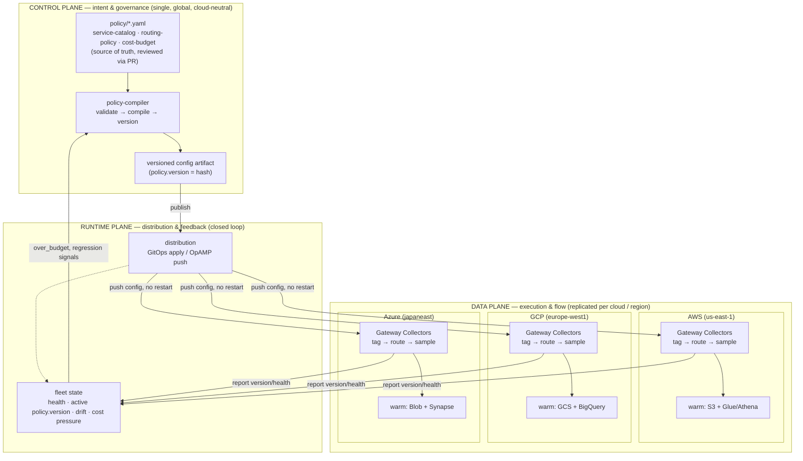

# A three-plane governance model for OpenTelemetry Collectors in multicloud

*Control plane, data plane, runtime plane — a reference governance model for
running a fleet of OpenTelemetry Collectors across more than one cloud,
without the policy drifting apart cloud by cloud. Grounded in the
[otel-gateway](https://github.com/) reference implementation (this
repository); honest about what is implemented here versus what the model
projects to at fleet and multicloud scale.*

---

## TL;DR

- Managing a **fleet** of Collectors is a different problem from configuring
  **one** Collector. The moment you have more than one, "edit the config
  file" stops being a strategy and becomes a source of drift.
- Borrowing the vocabulary that service meshes and Kubernetes made standard,
  this article separates the problem into three planes with distinct
  responsibilities and distinct failure modes:
  - **Control plane** — *intent & governance.* What the rules are, who
    approved them, under which version. Single, global, cloud-neutral.
  - **Data plane** — *execution & flow.* The Collectors that actually
    receive, process, and route telemetry. Replicated per cloud and region.
  - **Runtime plane** — *distribution & feedback.* How intent reaches the
    data plane without restarts, and how health, active version, drift, and
    cost pressure flow back. The reconciliation loop that keeps the two
    other planes honest.
- **In multicloud this separation is not optional.** The control plane stays
  single and authoritative; the data plane fragments by provider (different
  managed backends, different IAM, different egress economics, data-residency
  boundaries); the runtime plane is what gives you one fleet view across
  clouds instead of three disconnected ones.
- The `otel-gateway` repository implements the single-cloud (AWS) case end to
  end — policy-as-code, a compiler that emits a versioned config artifact,
  routing by value, a deployment ledger, and a budget-pressure feedback loop.
  The **multicloud generalization and the OpAMP-based runtime plane described
  here are a design, not applied infrastructure** — see
  [What is implemented vs. designed](#what-is-implemented-vs-designed).

---

## 1. The problem: fleet sprawl, multiplied by clouds

A single OpenTelemetry Collector is a solved problem. You write
`otelcol-config.yaml`, you run it, you move on.

The problems start at scale, and they compound:

1. **One config per collector does not survive contact with a fleet.** With
   dozens of Collectors, a routing or sampling rule copied into each one
   drifts: someone hotfixes one gateway during an incident, forgets the
   others, and three weeks later two regions sample errors differently and
   nobody can say why.
2. **The config file is not an audit trail.** "Which policy classified this
   span, and who approved it?" is a compliance question, and a Collector
   config on disk cannot answer it.
3. **Multicloud fragments the data plane but should *not* fragment the
   intent.** Running Collectors in AWS, GCP, and Azure means three different
   managed object stores, three IAM models, three egress price lists, and
   often hard data-residency boundaries (EU telemetry must not leave the EU).
   The naive outcome is three independent pipeline configurations that *claim*
   to implement the same governance but silently diverge — the single-collector
   drift problem, now per cloud.
4. **Change velocity fights safety.** You want to tighten a sampling rule or
   trip a cost circuit breaker in minutes, fleet-wide — but you also want a
   review gate, a version stamp, and a one-command rollback. A single
   mechanism rarely gives you both.

The thesis of this article: these are four *different* problems, and trying to
solve them with one artifact (a shared config file, or a single SaaS console)
is why observability governance tends to collapse into either chaos or
lock-in. Separate them into three planes and each gets a mechanism suited to
its failure mode.

---

## 2. The model: three planes, one source of truth



Three planes, one invariant: **intent lives in exactly one place.** The
control plane is the only authority on *what the rules are*; everything
downstream is a projection of it.

| Plane | Answers | Scope in multicloud | Primary failure mode it prevents | In this repo |
|---|---|---|---|---|
| **Control** | *What & why* — which rule, who approved it, under which version | **Single, global, cloud-neutral** (lives in Git/CI) | Divergent intent; unauditable change | `policy/*.yaml` → `policy-compiler/compile.py` → versioned artifact |
| **Data** | *What flows where* — receive, tag, route, sample, export | **Replicated per cloud & region** | Per-collector config drift; wrong-tier spend | Gateway Collector (`transform` + `routingconnector` + `tail_sampling`) |
| **Runtime** | *How intent reaches the fleet, and what the fleet reports back* | **Bridges the two across clouds** | Restart-to-change; silent drift; cost blowout | Budget circuit breaker + deployment ledger + OpAMP adoption path |

The planes are **layers, not competitors**. This is the same insight the
[control-plane comparison](control-plane-comparison.md) makes about GitOps and
OpAMP: GitOps is not an alternative to a control plane product; it is the
*control plane*, and OpAMP is the *runtime plane* that distributes what GitOps
decides. Confusing the two — letting a distribution UI become a second source
of truth — is the classic governance anti-pattern.

---

## 3. Control plane — intent as code, compiled and versioned

The control plane's only job is to hold the **intent** and turn it into an
unambiguous, versioned, auditable artifact. It never touches a Collector
directly. It is deliberately cloud-agnostic: nothing in it knows or cares that
the data plane runs on three providers.

In `otel-gateway` the control plane is three YAML files and a compiler:

- **`policy/service-catalog.yaml`** — what a service *is*: criticality tier,
  owning team, cost center, compliance obligation. Declared and owned by the
  platform team, not inferred from naming conventions.
- **`policy/routing-policy.yaml`** — an ordered, first-match-wins decision
  matrix combining the catalog with signal-level criteria (severity, span
  status, SLO relevance) and **environment/region/cloud** conditions.
- **`policy/cost-budget.yaml`** — per-service volume budgets that feed the
  runtime cost circuit breaker.

`policy-compiler/compile.py` is the controller. It:

1. Validates all three files against a JSON Schema and a **closed condition
   vocabulary** (`conditions.json`) — an unknown condition fails the build,
   not production.
2. Compiles the decision matrix into OTTL expressions inside a
   `transformprocessor` and a `routingconnector` table.
3. Generates the Prometheus cost recording rules from the *same*
   `cost-budget.yaml` — one source feeding both the pipeline and the FinOps
   view.
4. Stamps a **`policy.version`** (a hash of the active policy) onto every
   routed signal and onto the generated artifact.

That last point is the whole governance guarantee. Every span, log, and metric
carries the version of the policy that classified it; every deployment is
recorded in an append-only ledger (`deployments/ledger.jsonl`: env,
`policy.version`, git sha, actor, timestamp). "Under which policy was this data
classified, and who approved it?" becomes a `git blame` plus a ledger lookup —
not an archaeology project.

**Why a compiler and not hand-edited YAML per collector.** The same reason
Kubernetes has controllers and you don't `kubectl edit` pods in a loop: the
human-authored artifact (`policy/*.yaml`) is small, reviewable, and declares
*intent*; the machine-generated artifact (`otelcol-config.generated.yaml`, 21 KB
of OTTL) is large, mechanical, and declares *mechanism*. Humans review intent;
machines own mechanism. Anti-drift CI recompiles on every PR and fails if the
committed mechanism does not match the intent.

**Authoring is not the governance.** The repo offers three interchangeable
authoring surfaces — a static visual decision-matrix editor, a `policyctl` CLI
wizard, and hand-edited YAML — but all three converge on the same
`policy/*.yaml` and the same compiler. The visual editor can *save and apply to
localhost*, but it has **no push and no PR bypass**: the pull request is still
the gate. A UI that writes directly to production is a second source of truth,
and that is exactly the failure this plane exists to prevent.

---

## 4. Data plane — execution, replicated per cloud

The data plane is the Collectors themselves. It is where bytes actually move,
and it is the plane that *must* fragment in multicloud — because the backends,
the IAM, and the egress economics genuinely differ per provider.

### Topology: agent tier + gateway tier

The production topology this model assumes (the local demo collapses it to a
single gateway for simplicity):

- **Agent Collectors** — one per host/pod (DaemonSet/sidecar). They *only*
  receive and forward via OTLP. **No policy logic.** They absorb local spikes
  and live close to the application. Keeping them dumb is deliberate: policy in
  the agent tier is the drift problem at its worst, because there are thousands
  of them.
- **Gateway Collectors** — a stateless, horizontally scalable fleet *per cloud
  and region*. All the governance mechanism lives here: tagging
  (`service.tier`/`team`/`cost_center`), routing by value
  (`routingconnector` → hot/warm/drop), tail sampling, and cost counting.

Each signal type (logs, traces, metrics) flows through the same shape, all of
it generated by the control plane's compiler:

```
receivers.otlp                     → single entry point (from Agent Collectors)
processors.transform/tag_<signal>  → tags tier/team/cost_center + decides telemetry.tier (OTTL)
connectors.routing/<signal>        → splits hot | warm | drop by telemetry.tier
connectors.count/<signal>_<tier>   → counts by service/team/cost_center (cost showback)
processors.filter/drop_<signal>    → discards the drop branch *after* counting
exporters (hot)                    → otlp/tempo, otlphttp/loki, prometheusremotewrite
exporters (warm)                   → object store (S3 / GCS / Azure Blob), partitioned Parquet
```

### Routing by value, not by volume

The decision matrix the compiler produces (full rationale in
[routing-policy.md](routing-policy.md)) is four rules, first match wins:

1. **Compliance override** — `compliance_hold: true` → always warm, never
   dropped. This is rule #1 by construction: no cost optimization may violate a
   retention obligation.
2. **Error / SLO upgrade** — an error log, error-status span, or SLO-relevant
   metric moves up a tier. Diagnosability is never silently dropped.
3. **Base classification by tier** — absent an error, a critical service's
   *normal* traffic goes to warm, not hot. Most of what a critical service
   emits under normal operation does not need premium retention.
4. **Budget-pressure downgrade** — a cost circuit breaker (see the runtime
   plane): non-error signals from an over-budget service drop one tier until
   volume normalizes. Error signals are exempt.

### Why the data plane is the plane that goes multicloud

The hot and warm backends are **cloud-local by necessity**:

| Concern | AWS | GCP | Azure |
|---|---|---|---|
| Warm object store | S3 | Google Cloud Storage | Azure Blob Storage |
| Warm query engine | Athena + Glue | BigQuery / BigLake | Synapse / Fabric |
| Export identity | IAM role | Workload Identity | Managed Identity |
| Collector warm exporter | `awss3exporter` | `googlecloudstorageexporter` | `azureblobexporter` |

Three things make this heterogeneity governable rather than chaotic:

- **The intent is identical.** All three gateways run a config compiled from
  the *same* `policy/*.yaml`. The only per-cloud delta is the exporter block
  and its credentials — mechanism, not intent.
- **`region` and `cloud` are first-class routing conditions.** The closed
  vocabulary already includes `region` and `env`; `cloud.region` /
  `cloud.provider` are standard OpenTelemetry resource attributes. So "EU
  telemetry stays in `europe-west1`" or "route Japan-region critical traffic to
  the `japaneast` warm tier" is a *policy rule*, authored once in the control
  plane, not a per-cloud config fork. **Data residency becomes a reviewable
  line in a PR**, which is exactly where a compliance auditor can find it.
- **Egress is designed out.** Each gateway writes to its *own* cloud's object
  store. Telemetry does not cross cloud boundaries to reach a warm tier; only
  the small, aggregated cost/health metrics flow to the runtime plane. Cross-
  cloud egress on raw telemetry is one of the fastest ways to turn an
  observability bill into a networking bill.

---

## 5. Runtime plane — distribution and the feedback loop

The runtime plane is what most "config-as-code" write-ups miss. The control
plane decides intent; the data plane executes it; but *how does new intent
reach a 200-Collector fleet across three clouds, and how do you know it
actually landed?* That is a distinct plane with its own protocol and its own
telemetry, and it closes the loop back to the control plane.

### Two directions

- **Distribution (control → data):** push the compiled artifact to the fleet.
- **Feedback (data → control):** report per-Collector health, the *active*
  `policy.version`, drift, and cost pressure back up.

### The feedback that already exists: the cost circuit breaker

`otel-gateway` implements one concrete runtime feedback loop today. A Prometheus
recording rule (generated by the control plane from `cost-budget.yaml`) exposes
`over_budget=1` per service when its rolling volume exceeds budget. A periodic
job (`make recompile-policy-with-budget`) reads that signal, recompiles the
policy with the `budget-pressure-downgrade` rule active, and redeploys. That is
a real closed loop: **cost pressure observed in the data plane changes the
intent the data plane executes** — autonomously, bounded by a policy a human
reviewed, and with error signals explicitly exempt so diagnosability never
loses to a budget line.

It is deliberately a *"poor man's control plane"*: it requires a Collector
restart on every change. That is the honest limitation, and it is exactly what
the next step removes.

### The distribution the model projects to: OpAMP

At fleet and multicloud scale, the distribution mechanism is **OpAMP (Open
Agent Management Protocol)** — the CNCF/OpenTelemetry standard for managing
agent fleets. OpAMP gives the runtime plane:

- **Config push without restarts** — new `policy.version` reaches every gateway
  in every cloud live.
- **Health and active-version reporting per Collector** — the fleet view that
  makes **drift visible**: "gateway-aws-3 is still on `policy.version` abc123
  while the rest of the fleet is on def456" is a dashboard row, not a
  three-week-later incident.
- **Central rollback** — "serve the previous `policy.version`"; the ledger
  already pins every one.

Because the compiler already emits a **versioned, distribution-independent
artifact**, OpAMP is a drop-in *runtime-plane* upgrade, not an architecture
rewrite. The adoption path (detailed in
[control-plane-comparison.md](control-plane-comparison.md)):

1. Keep `policy/*.yaml` + `compile.py` as the control plane and CI gate.
2. Stand up an OpAMP server (the OpenTelemetry OpAMP supervisor, or an
   open-source control plane such as Bindplane) that serves the compiled
   artifact to the gateway fleet.
3. CI publishes the artifact to the OpAMP server on merge instead of
   restarting a container; the server pushes it with no restart and reports the
   active `policy.version` per Collector.
4. Rollback becomes "serve a previous `policy.version`."

### Why OpAMP matters more in multicloud specifically

In one cloud you can hack distribution with Terraform or a config-reload
sidecar. Across three clouds, a per-cloud distribution mechanism *is* the drift
problem — you would be managing three ways to ship config and three definitions
of "current version." OpAMP gives you **one fleet, one version axis, one drift
dashboard**, regardless of which cloud a Collector runs in. The runtime plane is
the plane that makes "multicloud" look like "one fleet" instead of "three
fleets that happen to share a Git repo."

---

## 6. Governance guarantees the model delivers

Mapping the three planes back to the properties a platform/observability team
is actually accountable for:

| Governance requirement | Plane | Mechanism |
|---|---|---|
| **Auditability** — which policy classified this signal, who approved it | Control | `policy.version` stamped on every signal + Git history + `CODEOWNERS` review |
| **Traceability** — what was deployed where, when | Control + Runtime | `deployments/ledger.jsonl` (env, version, sha, actor, ts) + GitHub Deployments |
| **Compliance / data residency** | Control → Data | `compliance_hold` (never-drop) + `region`/`cloud` routing conditions, authored once |
| **Drift detection** | Runtime | OpAMP active-version reporting; anti-drift CI for the artifact itself |
| **Safe rollback** | Control + Runtime | Deterministic: each deploy pins git sha + `policy.version`; rollback = serve a prior version |
| **Cost control** | Data + Runtime | Routing by value + budget circuit breaker (`over_budget` → downgrade) + showback |
| **No lock-in** | Control | Intent is plain YAML + a compiler; the runtime plane is swappable (GitOps today, OpAMP later, Bindplane/Grafana Fleet if bought) |

A useful litmus test for any observability-governance proposal: *can it answer
each row above with a mechanism, not a meeting?* The three-plane split is what
lets each row have a concrete owner.

---

## 7. Trade-offs: how far up the runtime plane to climb

The control and data planes are non-negotiable — you need intent-as-code and
Collectors regardless. The real decision is **how sophisticated the runtime
plane needs to be**, and that is a genuine trade-off, not a maturity ladder you
must climb to the top of.

| Dimension | GitOps-only runtime (this repo) | OpAMP / control-plane product (Bindplane, Grafana Fleet, Cribl) |
|---|---|---|
| Source of truth | Git (YAML, PR, `git blame`) | Git (if GitOps-synced) or a product DB (drift risk) |
| Applying a change | recompile + redeploy/restart | live push, no restart |
| Fleet view / drift | you build it (Prometheus + ledger) | native: health, active version, rollback |
| Multicloud fleet view | DIY per cloud, stitched | one pane across clouds (OpAMP) |
| Audit / compliance | excellent (`policy.version` + Git) | product-dependent; UI↔Git drift risk |
| Lock-in / cost | ~zero (Git + CI) | SaaS cost or a stateful service to operate |
| Proven scale | great for *what/why*; distribution is on you | 500k+ agents (Bindplane) |
| Standard maturity | Git/CI = commodity | **OpAMP is beta**, stabilizing; Grafana Fleet Mgmt is GA |

**Stay GitOps-only** when: a small set of expert authors, change cadence
tolerates redeploy, and auditability + zero lock-in dominate. A single-cloud or
early multicloud footprint fits here — this is where `otel-gateway` sits.

**Add an OpAMP runtime plane** when: many heterogeneous Collectors across
clouds, authors including non-experts, or you need no-restart changes, cross-
cloud drift visibility, and central rollback. Multicloud at real scale pushes
you here faster than single-cloud does, because the runtime plane is where
multicloud complexity concentrates.

Keep one rule invariant regardless of how high you climb: **the control plane
stays in Git.** A bought product earns its place as a *runtime plane* that
distributes what Git decides and commits its UI edits *back* to Git — never as a
replacement source of truth.

---

## 8. Adoption path (crawl → walk → run)

1. **Crawl — intent as code (control plane).** Move routing/sampling/retention
   out of Collector configs into a reviewed `policy/*.yaml` + a compiler that
   emits the Collector config. Stamp a version. Record deploys in a ledger. *You
   now have audit and rollback, single-cloud.* (This repo, today.)
2. **Walk — routing by value + feedback (data + runtime).** Add the service
   catalog, route hot/warm/drop by business value, add the budget circuit
   breaker. *You now have cost control with SLO fidelity.* (This repo, today.)
3. **Run — OpAMP runtime plane, multicloud (runtime).** Replicate the gateway
   data plane per cloud with cloud-local warm tiers; make `region`/`cloud`
   first-class routing conditions for residency; distribute the *same* compiled
   artifact to all clouds via OpAMP with per-Collector version/health
   reporting. *You now have one governed fleet across clouds.* (The design in
   this article.)

Each step is independently valuable and independently shippable. You do not
need OpAMP to get audit; you do not need multicloud to get cost control. The
three-plane split is what lets you add capability one plane at a time without
re-architecting.

---

## What is implemented vs. designed

Stated plainly, because a reference architecture that blurs this line is worse
than useless:

| Capability | Status in this repo |
|---|---|
| Control plane: policy-as-code, compiler, `policy.version`, closed vocabulary, anti-drift CI, dev→uat promotion, ledger, rollback | **Implemented** and validated against the real `otelcol-contrib` binary |
| Data plane (single cloud): tag → route by value → tail-sample → count → export; hot (Tempo/Loki/Prometheus) + warm (MinIO≈S3) | **Implemented**; the full docker-compose stack is not exercised end-to-end in the build sandbox (see repo README) |
| Runtime feedback: budget circuit breaker (`over_budget` → recompile + restart) | **Implemented** — the "poor man's control plane" |
| `region` / `env` routing conditions in the closed vocabulary | **Implemented** (the multicloud/residency hook already exists) |
| Warm tier infrastructure (S3 + Glue + Athena + IAM) | **Written in Terraform, not applied** (AWS only) |
| **Multicloud data plane** (GCP/Azure gateways + GCS/Blob warm tiers + per-cloud IAM) | **Designed, not implemented** |
| **OpAMP runtime plane** (no-restart push, fleet version/health, central rollback) | **Designed, not implemented** — but the artifact is already versioned and distribution-independent, so it is a drop-in, not a rewrite |

The single-cloud case study is real and runnable. The multicloud generalization
and the OpAMP runtime plane are the honest next steps this architecture was
built to grow into — and the compiler was deliberately designed to make them a
distribution upgrade rather than a redesign.

---

## References

- OpenTelemetry — Collector management & OpAMP:
  <https://opentelemetry.io/docs/collector/management/>,
  <https://opentelemetry.io/docs/specs/opamp/>
- OpenTelemetry — resource semantic conventions (`cloud.provider`,
  `cloud.region`):
  <https://opentelemetry.io/docs/specs/semconv/resource/cloud/>
- CNCF — Operating OpenTelemetry at scale with OpAMP:
  <https://www.cncf.io/blog/2026/07/13/operating-opentelemetry-at-scale-with-opamp/>
- Bindplane — OpAMP for OpenTelemetry / managing Collector fleets:
  <https://bindplane.com/blog/opamp-for-opentelemetry-managing-collector-fleets-and-introducing-the-new-opamp-gateway-extension>
- Grafana Labs — Fleet Management GA:
  <https://grafana.com/blog/telemetry-pipeline-management-at-any-scale-fleet-management-in-grafana-cloud-is-generally-available/>
- Honeycomb — OpAMP explained:
  <https://www.honeycomb.io/blog/opamp-explained-why-opentelemetry-needed-agent-management-protocol>

## Appendix — mapping the model to this repository

| Plane | Artifact(s) in `otel-gateway` |
|---|---|
| Control | `policy/service-catalog.yaml`, `policy/routing-policy.yaml`, `policy/cost-budget.yaml`, `policy-compiler/compile.py`, `policy-compiler/conditions.json`, `.github/workflows/policy-*.yml`, `deployments/ledger.jsonl` |
| Data | `collector/config/otelcol-config.generated.yaml` (receivers → `transform` → `routingconnector` → `count` → `filter` → exporters), `collector/config/otelcol-config.template.yaml` (readable shape) |
| Runtime | budget circuit breaker (`make recompile-policy-with-budget` + `prometheus/rules/`), `deployments/ledger.jsonl` rollback, OpAMP adoption path in `docs/control-plane-comparison.md` |

Companion documents: [architecture.md](architecture.md),
[routing-policy.md](routing-policy.md), [cost-model.md](cost-model.md),
[governance-authoring.md](governance-authoring.md),
[control-plane-comparison.md](control-plane-comparison.md).
